<!-- HEADER -->
<h1 align="center">Hi 👋, I'm Sivaganesh</h1>
<h3 align="center">Building Aayvu • Full-Stack • Cloud • Security</h3>

  <a href="https://siv19.dev/">🌐 Website</a> •
  <a href="https://aayvu.io/">🚀 Aayvu</a> •
  <a href="https://linkedin.com/in/sivab193">💼 LinkedIn</a> •
  <a href="https://github.com/sivab193">🐙 GitHub</a> •
  <a href="https://ieeexplore.ieee.org/author/37089725626">📄 IEEE</a> •
  <a href="mailto:contact@siv19.dev">📧 Email</a>

  

<!-- ANIMATED PROFILE CARD (self-generated, theme-aware, auto-updated daily) -->

  <a href="https://github.com/sivab193">
    <picture>
      <source media="(prefers-color-scheme: dark)" srcset="https://raw.githubusercontent.com/sivab193/sivab193/main/assets/dark.svg">
      <source media="(prefers-color-scheme: light)" srcset="https://raw.githubusercontent.com/sivab193/sivab193/main/assets/light.svg">
      
    </picture>
  </a>

<i>↑ generated daily from the GitHub API — no third-party badge services</i>

---

## 🚀 Currently Building: Aayvu

**Aayvu** ([aayvu.io](https://aayvu.io/)) is an AI-powered survey platform, deeper than SurveyMonkey: complex branching and automation under the hood, in the spirit of Qualtrics.

Currently focused on building Aayvu, with the US co-founder and India co-founder team. Stack: AWS LLM APIs plus other free-tier models, deployed on Zoho Catalyst.

---

## 📊 Biggest Builds — by lines of code

  <a href="https://github.com/sivab193?tab=repositories">
    <picture>
      <source media="(prefers-color-scheme: dark)" srcset="https://raw.githubusercontent.com/sivab193/sivab193/main/assets/repos-dark.svg">
      <source media="(prefers-color-scheme: light)" srcset="https://raw.githubusercontent.com/sivab193/sivab193/main/assets/repos-light.svg">
      
    </picture>
  </a>

<!-- ORGS-START -->
_No org repos with authored lines found on the last run. Check that GH_PAT has `read:org` scope and is authorised for those orgs._
<!-- ORGS-END -->

### 🔒 Private builds — named, code stays private

<!-- PRIVATE-START -->
_No private repos with authored lines found on the last run._

_Names only, no links. Code stays private. Restricted (private) contributions in this period: 120._
<!-- PRIVATE-END -->

---

## 🧠 What I'm Working On

**Main builds:**

- 🚀 [Aayvu](https://aayvu.io/) — AI-powered survey programming: branching, automation, and LLM-powered survey building
- 🎬 [MediaVerse](https://www.media-verse.in/) — full-stack movie tracker with watch-time leaderboards and theater check-ins
- 📋 [CloudClip](https://www.cclip.cc/) — a quieter way to move text, encrypted before it leaves the browser
- 💸 [SplitLLM](https://splitllm.com/) — scan receipts, split expenses with friends, and settle up, with receipt-reading AI

**Also:**

- ☁️ Cloud & distributed systems — self-hosted infra, API gateways, real-time trackers
- 🔐 Security & authentication — passkeys, replay-attack detection, secure gateways
- 📱 Full-stack & mobile — Next.js / React Native products, shipped end-to-end
- 📚 Research & publications — IEEE-published work

---

## 💓 Commit Pulse

  <a href="https://github.com/sivab193">
    <picture>
      <source media="(prefers-color-scheme: dark)" srcset="https://raw.githubusercontent.com/sivab193/sivab193/main/assets/pulse-dark.svg">
      <source media="(prefers-color-scheme: light)" srcset="https://raw.githubusercontent.com/sivab193/sivab193/main/assets/pulse-light.svg">
      
    </picture>
  </a>

---

## 🤝 Let's Connect

🚀 Building Aayvu &nbsp;·&nbsp; 📬 Best reached on [LinkedIn](https://linkedin.com/in/sivab193) or [contact@siv19.dev](mailto:contact@siv19.dev)
